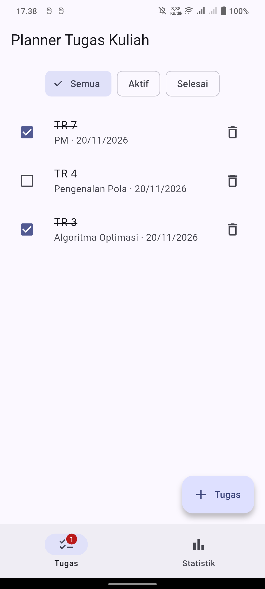
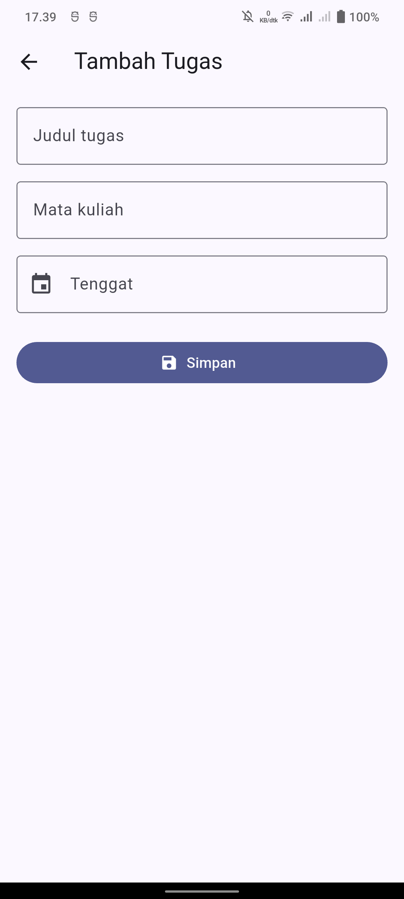
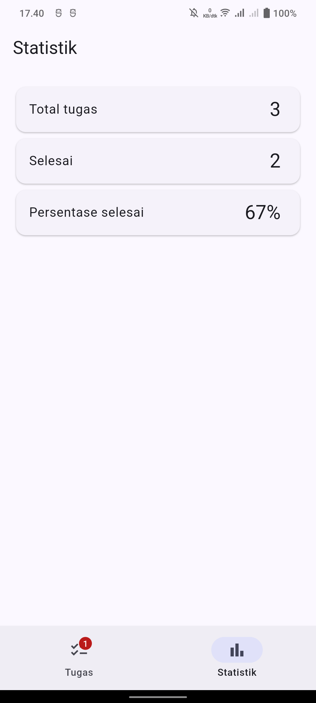

# Planner Tugas Kuliah
Tugas rutin 7 (Pemrograman mobile)

## Identitas
- Nama : M. FARIS AL RAFIQ
- NIM : 4241250001
- Kelas : PSIK24C

## Tangkapan Layar
| Daftar | Form | Statistik |
|---|---|---|
|  |  |  |

## Letak State dan Alasannya

| State | Jenis | Lokasi | Alasan |
|---|---|---|---|
| Daftar tugas (tambah, selesai, hapus) | Bersama (app state) | `TugasModel` (Provider) | Dipakai halaman daftar, statistik, dan badge navigasi |
| Filter Semua/Aktif/Selesai | Lokal (ephemeral) | `_HalamanDaftarState` (`setState`) | Hanya dipakai satu halaman |
| Isi kolom form dan tanggal terpilih | Lokal (ephemeral) | `_HalamanFormState` | Hanya dipakai form |

Diagram sederhana:

​```
ChangeNotifierProvider<TugasModel>        <- state bersama
 └─ MaterialApp.router
     ├─ KerangkaNavigasi  (select: jumlahAktif -> badge)
     │   ├─ HalamanDaftar   (watch + filter via setState)
     │   └─ HalamanStatistik (watch)
     └─ HalamanForm (controller: initState/dispose, read -> tambah)
​```

## Penjelasan
Aplikasi ini membagi state menjadi dua bagian. State tugas, seperti menambah, menandai selesai, dan menghapus tugas, termasuk state bersama karena digunakan oleh halaman daftar, statistik, dan badge navigasi. Karena itu, saya menyimpannya dalam `TugasModel` yang menggunakan `ChangeNotifier` dan disediakan melalui Provider di atas `MaterialApp.router`. Saya memilih Provider daripada Cubit karena aplikasi ini masih berskala kecil, sehingga penggunaannya lebih sederhana. Selain itu, modelnya mudah diuji menggunakan unit test tanpa perlu UI. Setiap kali data berubah, `notifyListeners()` dipanggil agar widget yang mendengarkannya ikut diperbarui.

Pada bagian UI, saya menggunakan `context.watch` di dalam `build()` halaman daftar dan statistik agar tampilan mengikuti perubahan data. Sementara itu, `context.read` digunakan pada callback seperti `onPressed` karena hanya perlu menjalankan method tanpa mendengarkan perubahan. Badge navigasi menggunakan `context.select` agar hanya diperbarui ketika nilai `jumlahAktif` berubah.

Filter Semua/Aktif/Selesai termasuk ephemeral state karena hanya digunakan pada satu halaman. Oleh karena itu, saya cukup mengaturnya menggunakan `setState` di `_HalamanDaftarState`.

Untuk mengatur lifecycle, `TextEditingController` pada halaman form dibuat melalui `initState()` dan dihapus melalui `dispose()` agar tidak terjadi kebocoran memori. Setelah `await showDatePicker`, saya memeriksa `mounted` sebelum menjalankan `setState` untuk mencegah error `setState() called after dispose()`.

## Pengujian
Hasil `flutter test`: 00:03 +4: All tests passed! 

## Pernyataan Penggunaan AI
Saya menggunakan Claude sebagai pendamping belajar dalam mengerjakan tugas ini, membimbing pengerjaan langkah demi langkah. Saya menjalankan seluruh kode di perangkat Android sendiri, menguji setiap fitur, dan mempelajari alasan di balik pilihan Provider, watch/read/select, serta pengelolaan controller di initState dan dispose.